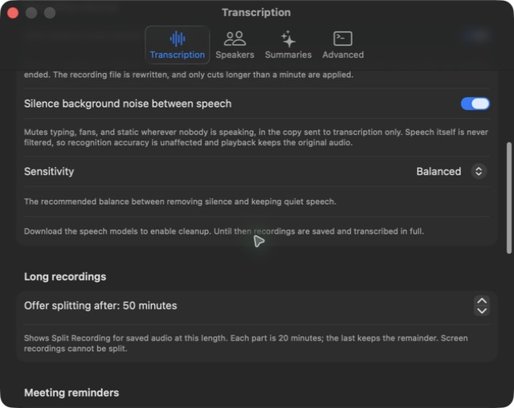
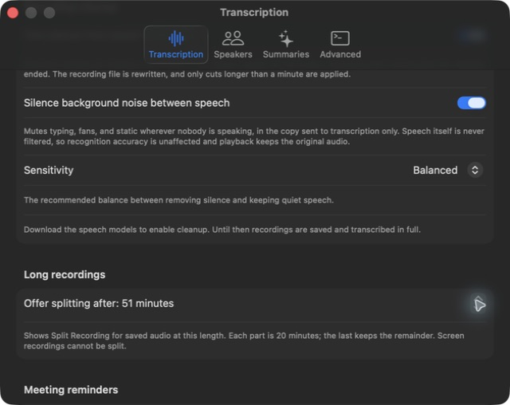
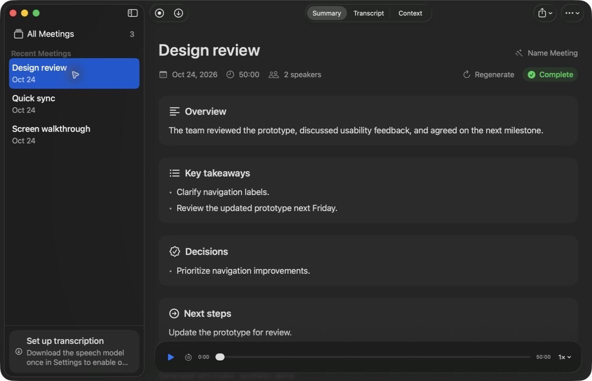
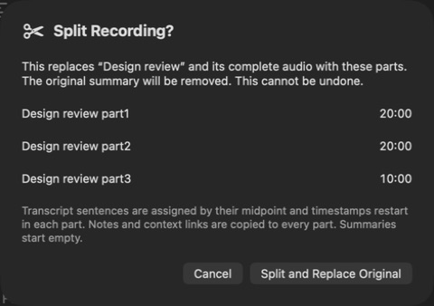
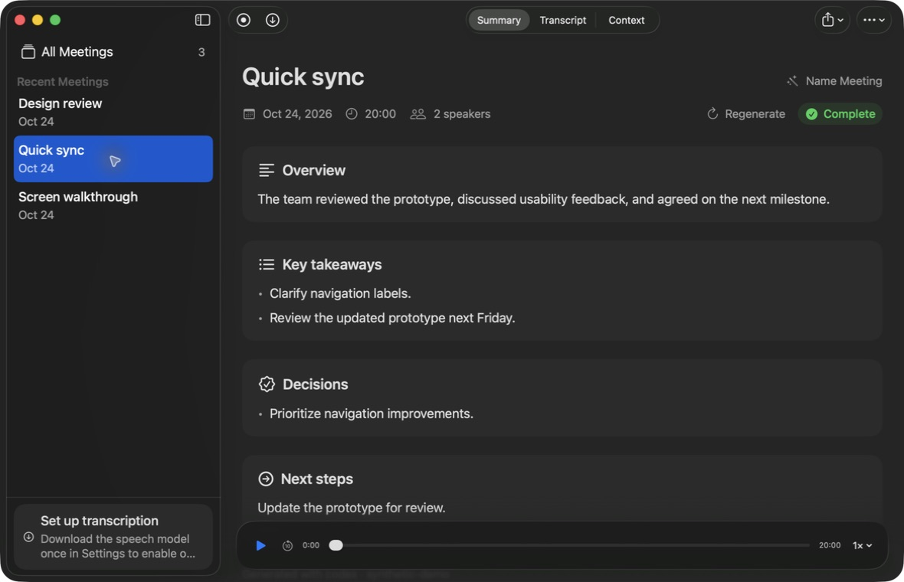
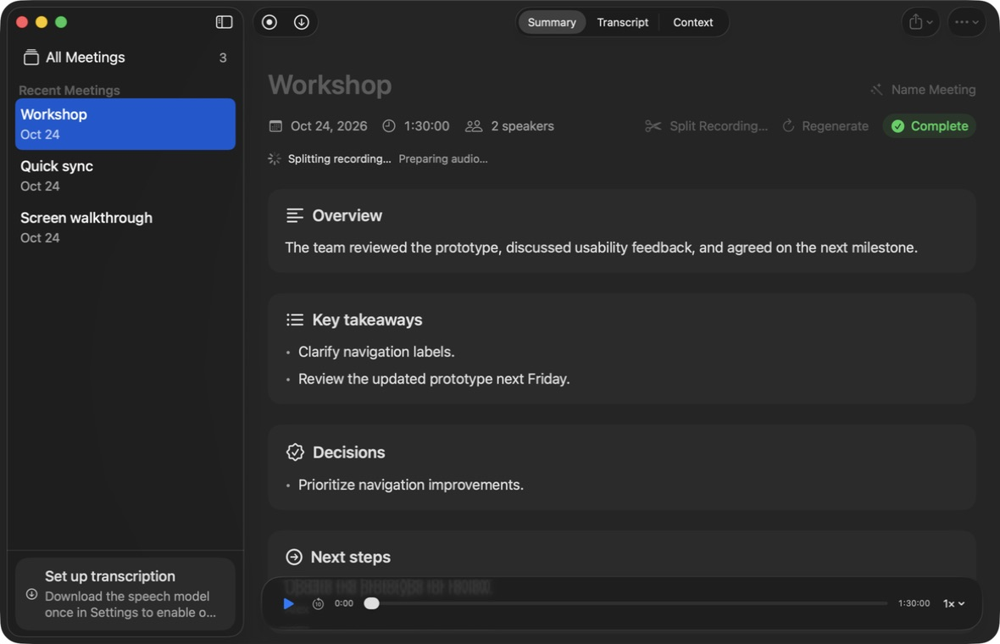

# Split recording acceptance screenshots

Captured from the native debug app with an isolated `STILLNOTE_DATA_DIR` and synthetic audio, transcripts and context. No private meeting content is included.

The progress capture uses a separate 90-minute synthetic workshop with the QA process temporarily CPU-throttled using STOP/CONT signals. No artificial delay or screenshot hook is present in the application code. All other captures use the normal-speed 50-minute flow.

Verified: cancel leaves the original untouched; changing the threshold immediately changes visibility; successful replacement persists after restart; all four source sentences appear exactly once across the three parts; original audio is removed only after replacement; notes, links and speaker identities survive.

## Default 50-minute threshold

## Threshold changed to 51 minutes

## 50-minute recording hidden below the custom threshold

## Split action at the 50-minute threshold

## Replacement confirmation with all part names and durations

## Short recording without a split action

## Screen recording excluded

## Export in progress with conflicting actions disabled

## Part 1 opens with an empty summary

## Part 2 transcript starts at zero

## Independent part playback

## Notes and links preserved in each part

## Original replaced by 20-, 20-, and 10-minute parts

